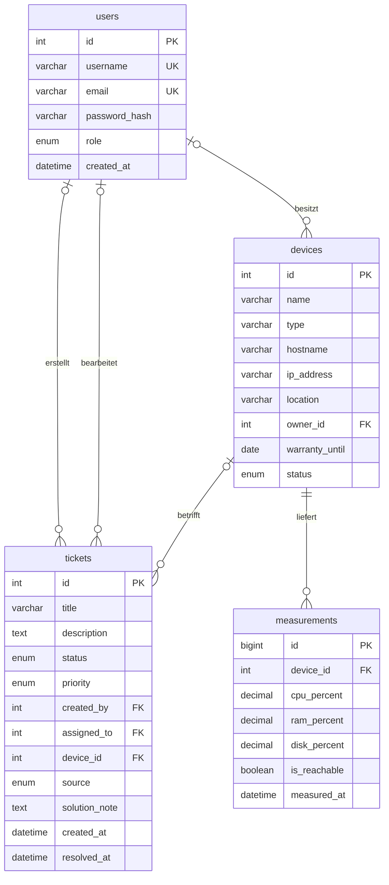

# Datenmodell

- Passwörter werden nur als BCyrpt-Hash gespeichert.
- `tickets.source` unterscheidet Tickets von Menschen (`manuell`) und vom Agent (`agent`).
- Der Datenbankbennutzer der Anwendung hat nur Rechte auf die Datenbank `servicedesk`.