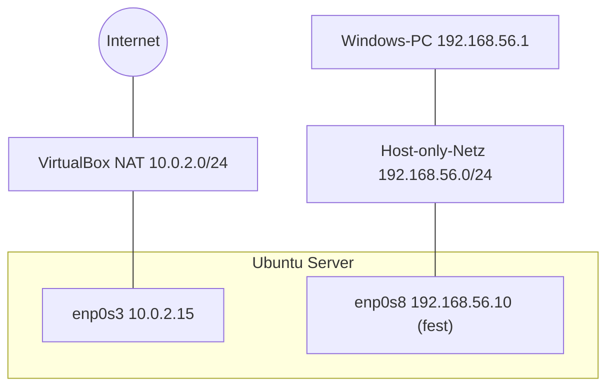

# Netzwerk

| Gerät | Adapter | Adresse | Art |
| --- | --- | --- | --- |
| Ubuntu Server | enp0s3 (NAT) | 10.0.2.15 | automatisch (DHCP), Zugang ins Internet |
| Ubuntu Server | enp0s8 (Host-only) | 192.168.56.10/24 | fest (Netplan) |
| Windows-PC | Host-only-Adapter | 192.168.56.1 | fest (VirturalBox) |
| DHCP-Bereich Host-only |  | 192.168.56.101 bis .254 | feste IP bewusst außerhalb |

Freigegeben in der Firewall (ufw): 22 (SSH), 80 und 443 (Nginx).